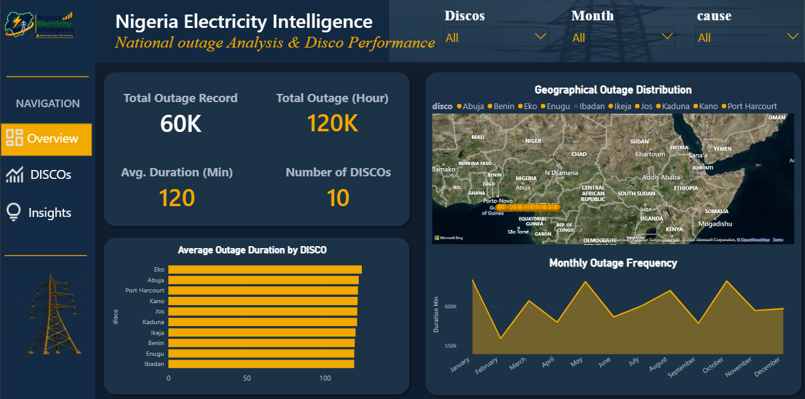

# Nigeria Electricity Distribution Analysis

## Project Overview
This project investigates electricity distribution outages and fault incidents across Nigeria using SQL and Power BI. The analysis focuses on understanding outage frequency, duration, causes and patterns across electricity distribution companies (DISCOs).

The goal is to generate insights that can support better operational decisions and improve electricity distribution reliability.

## Business Problem
Unreliable electricity supply creates challenges for households, businesses and economic activities across Nigeria.

However, understanding the scale and distribution of outages requires analysing historical outage records.

This project explores the following questions:

- Which DISCO records the highest number of outages?
- Which DISCO experiences the longest outage durations?
- What are the major reported causes of outages?
- How do outage patterns change over time?
- What insights can help stakeholders improve electricity distribution?

## Tools and Technologies
- **PostgreSQL:** Data exploration, cleaning and SQL analysis.
- **Microsoft Power BI:** Data modelling, visualisation and dashboard development.
- **CSV:** Dataset format.

## Dataset
**Dataset:** `nigerian_energy_and_utilities_outage_fault_logs.csv`

The dataset contains electricity outage and fault records, including information such as:

- Outage start and end times
- Outage duration
- Distribution companies (DISCOs)
- Reported causes
- Feeder identification
- Geographic coordinates

## Project Methodology

1. **Data Exploration:** Examined the dataset to understand its structure, fields and quality.
2. **Data Cleaning:** Investigated inconsistencies and prepared the data for analysis.
3. **SQL Analysis:** Used PostgreSQL to explore outage patterns and extract business insights.
4. **Data Visualisation:** Developed an interactive Power BI dashboard to communicate findings.
5. **Recommendations:** Identified potential areas for operational improvement.

## Dashboard Preview

## Key Insights
The analysis examines outage frequency, duration, distribution companies and reported causes to identify patterns in electricity distribution reliability.

*Detailed findings and recommendations are presented in the dashboard.*

## Recommendations
The findings can help electricity distribution companies and relevant stakeholders:

- Identify areas experiencing frequent outages.
- Investigate recurring causes of electricity interruptions.
- Prioritise operational improvements based on outage duration and frequency.
- Use historical outage data to support infrastructure and maintenance decisions.

## Project Files

| File | Description |
|---|---|
| `Outage.sql` | SQL analysis queries |
| `Nigeria_Electricity_dashboard.pbix` | Interactive Power BI dashboard |
| `nigerian_energy_and_utilities_outage_fault_logs.csv` | Original dataset |
| `Image.png` | Dashboard screenshot |

## Conclusion
This project demonstrates how SQL and Power BI can be combined to transform raw electricity outage records into meaningful business insights that support data-driven decision-making.

**Tools:** PostgreSQL | Power BI | SQL | Data Analytics
